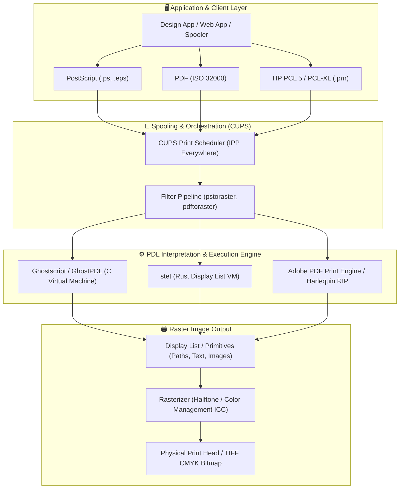

# 📄 Awesome Page Description Language Engines 🖨️

### *A Curated Directory of PostScript Interpreters, PCL Renderers, Raster Image Processors (RIP) & Open Print Pipelines*

  
  
  
  
  
  
  

**Keywords:** `page description language`, `postscript interpreter`, `pcl renderer`, `raster image processor`, `ghostscript`, `ghostpdl`, `cups`, `pdf-rendering`, `print-pipeline`, `ipp-everywhere`, `open-source-printing`

---

## 📑 Table of Contents

- [🔍 Overview](#-overview)
- [🌐 Sector Overview & Market Dynamics](#-sector-overview--market-dynamics)
- [🏢 SaaS & Commercial Hosted Platforms](#-saas--commercial-hosted-platforms)
- [💻 Open-Source PDL & RIP Engines](#-open-source-pdl--rip-engines)
  - [⭐ Open-Source Projects (Ranked by GitHub Stars)](#-open-source-projects-ranked-by-github-stars)
  - [🧩 Architectural Comparison & Implementation Insights](#-architectural-comparison--implementation-insights)
- [🛠️ How to Contribute](#️-how-to-contribute)
- [⚖️ Disclaimer & Licensing Caveats](#️-disclaimer--licensing-caveats)
- [📈 Star History](#-star-history)
- [💖 Support & Sponsoring](#-support--sponsoring)

---

## 🔍 Overview

This repository tracks notable **SaaS platforms**, **commercial RIP SDKs**, and **open-source implementations** for **Page Description Languages (PDL) & Engines**. 

Page Description Languages — primarily **Adobe PostScript (Level 1, 2, 3)**, **HP PCL (PCL 5e, PCL 5c, PCL-XL / PCL 6)**, **PDF (ISO 32000-1 / 32000-2)**, and **XPS / OpenXPS** — describe the layout, vector typography, geometric primitives, and color separations of printed or displayed pages at a device-independent level. 

PDL Engines and **Raster Image Processors (RIPs)** interpret these commands, execute internal state machines, evaluate Bézier curves and color management profiles, rasterizing input streams into high-resolution continuous-tone bitmaps or halftoned rasters for physical printing presses, laser print engines, or digital display pipelines.

---

## 🌐 Sector Overview & Market Dynamics

The global market for Page Description Language (PDL) engines, Raster Image Processors (RIP), and digital print workflow software is estimated at **$4.2 Billion in 2026** and projected to expand at a **6.8% CAGR toward $6.1 Billion by 2032**, propelled by high-speed digital commercial packaging, direct-to-garment (DTG) print pipelines, and automated cloud document infrastructure.

From a structural perspective, the sector is **highly concentrated at the industrial OEM core** (a classic duopoly dominated by Adobe's PostScript/APPE and Hybrid Software's Harlequin RIP which power the overwhelming majority of commercial print engines and prepress servers), while exhibiting **moderate fragmentation across the cloud API and developer layer** where open-source runtimes (Ghostscript, CUPS, STET) and specialized document microservices provide agile, self-hosted alternatives.

---

## 🏢 SaaS & Commercial Hosted Platforms

The following table summarizes enterprise SaaS, cloud rendering APIs, and commercial OEM PDL engines, sorted descending by **Company Scale (Valuation / Revenue)**:

| 🏢 Platform / Provider | 📦 Core PDL Capabilities | 📊 Company Scale (Revenue / Valuation) | 💳 Starting Tier Pricing | 🎁 Free Tier Limits | 🎯 Primary Use Case |
| :--- | :--- | :--- | :--- | :--- | :--- |
| [**Adobe PostScript 3 & APPE**](https://www.adobe.com/products/postscript.html) *(Adobe Inc.)* | PostScript Language Level 3, Adobe PDF Print Engine (APPE 6), PDF 2.0 native RIP | **$195 Billion Market Cap** / **$21.4B Annual Revenue** *(NASDAQ: ADBE)* | **$50.00/month** (Adobe PDF Services API Starter plan, 1,000 transactions; $0.05/doc thereafter; OEM SDK starting at $15,000/yr) | **6-month free trial** with 500 free document transactions (no credit card required) | Reference enterprise print production, hardware OEM printer integration, contractual prepress color accuracy |
| [**Harlequin RIP**](https://www.hybridsoftware.com/products/harlequin-rip/) *(Hybrid Software Group)* | Multi-threaded PostScript 3, PDF 2.0, PCL 5e/c, PCL-XL raster image processing | **€85 Million Market Cap** / **€50.2M Annual Revenue** *(Euronext: HYSG)* | **$2,500.00/year** (Developer OEM RIP engine license seat; production server license starting at $4,950 one-off) | **30-day evaluation trial** with full SDK features and watermarked output upon partner qualification | High-throughput industrial digital presses, label & packaging printing, mission-critical RIP workflows |
| [**CloudConvert API**](https://cloudconvert.com/api) *(Lunaweb GmbH)* | Cloud PostScript (`.ps`, `.eps`), PCL 5/6, and PDF conversion & raster rendering engine | **~$8.5 Million ARR** *(Bootstrapped & Profitable SaaS)* | **$9.00 one-time** package (500 conversion credits) or **$9.00/month** (1,000 credits at $0.009/credit) | **25 free conversion minutes per day** forever with full PostScript/PCL API access | High-volume RESTful API conversions for web applications, SaaS microservices, and multi-format document pipelines |
| [**DocRaptor**](https://docraptor.com/) *(Expected Behavior LLC)* | Prince-powered high-fidelity CSS/HTML/XML to PDF and PostScript rendering engine | **~$4.0 Million ARR** *(Independent Bootstrapped SaaS)* | **$15.00/month** (Basic plan, 125 documents/month, $0.12 per extra document) | **Unlimited free test documents** forever (watermarked) + **7-day free trial** with 100 live production documents | High-precision programmatic PDF/PostScript generation, financial reporting, and complex transactional documents |
| [**ConvertAPI**](https://www.convertapi.com/) *(Baltic SaaS)* | Scalable cloud endpoints for PostScript (`ps`, `eps`) and PCL file parsing and rendering | **~$3.2 Million ARR** *(European Document SaaS)* | **$15.00/month** (1,500 conversion seconds/month) or **$30.00 prepaid package** (1,500 conversions) | **250 free conversions** one-time trial quota upon account registration | Developer-friendly cloud microservice for on-demand document transformation and print stream previews |
| [**VeryPDF Cloud API**](https://www.verypdf.com/online/cloud-api/) *(VeryPDF Software)* | Dedicated cloud PCL-to-PDF, PostScript-to-PDF, and vector rasterization endpoints | **~$2.5 Million ARR** *(Independent Software Vendor)* | **$19.95/month** (Silver Plan, 1,000 API conversion calls/month, $0.02 per extra call) | **14-day free trial** with 100 free API calls and sample code access | Legacy enterprise PCL/PostScript print spool conversion to web-viewable PDF/TIFF formats |

---

## 💻 Open-Source PDL & RIP Engines

### ⭐ Open-Source Projects (Ranked by GitHub Stars)

Below is the complete catalog of active open-source PostScript interpreters, PCL renderers, PDF processors, and print pipeline utilities, strictly sorted descending by GitHub star count:

1. [**pdfcpu**](https://github.com/pdfcpu/pdfcpu)  — **Pure Go PDF & Page Description Engine.**
   - **License:** Apache-2.0
   - **Highlights:** Zero-dependency PDF processing engine written entirely in Go. Supports validation (ISO 32000), page extraction, N-up booklet imposition, form stamping, watermarking, vector clipping, and image extraction.
   - **Caveat:** Primarily PDF-centric rather than native legacy PostScript interpreter.
   - **Best for:** Go backend services requiring fast, thread-safe PDF manipulation without CGO bindings.

2. [**qpdf**](https://github.com/qpdf/qpdf)  — **Structural Content-Preserving PDF Transformation Engine.**
   - **License:** Apache-2.0
   - **Highlights:** Industry-standard C++ engine for structural inspection, linearizing (fast web view), encryption, decryption, object streams, and token-level page content transformations.
   - **Caveat:** Does not perform rasterization to pixels; delegates rasterization to Ghostscript or MuPDF.
   - **Best for:** Pre-press PDF hygiene, digital archiving, and print workflow validation.

3. [**MuPDF**](https://github.com/ArtifexSoftware/mupdf)  — **Ultra-Fast Lightweight PDF, XPS & OpenXPS Renderer.**
   - **License:** AGPLv3 / Commercial (Artifex Software)
   - **Highlights:** Highly optimized C graphics library engineered for top-tier rasterization speed and minimal binary footprint. Delivers high-fidelity anti-aliased graphics, text extraction, and form filling for PDF, XPS, and EPUB.
   - **Caveat:** Does not natively execute PostScript or PCL code; focused on modern fixed-layout page descriptions.
   - **Best for:** High-performance mobile viewers, embedded document kiosks, and low-latency cloud rasterizers.

4. [**CUPS (Common UNIX Printing System)**](https://github.com/OpenPrinting/cups)  — **The Standards-Based Open-Source Printing System for Unix/Linux.**
   - **License:** Apache-2.0 (OpenPrinting)
   - **Highlights:** The universal print architecture for Linux, macOS, and BSD systems. Uses the Internet Printing Protocol (IPP Everywhere), provides standard `lp`/`lpr` CLI tools, and orchestrates modular filter chains converting application output into printer-ready PDL.
   - **Caveat:** CUPS is a print spooler and pipeline orchestrator, not a native PostScript/PCL interpreter; it invokes Ghostscript or Poppler filters for rendering.
   - **Best for:** Desktop, enterprise, and cloud print server spooling and multi-vendor printer network discovery.

5. [**PDFium Binaries**](https://github.com/bblanchon/pdfium-binaries)  — **Precompiled Builds for Google's PDFium Page Description Renderer.**
   - **License:** BSD-3-Clause / Apache-2.0
   - **Highlights:** Standalone binary distributions and C/C++ header bundles for Google Chromium's PDFium rendering engine. Powers page rendering, text extraction, and rasterization across all desktop and embedded architectures.
   - **Caveat:** Chrome-tailored codebase with complex upstream build requirements when compiled from raw source.
   - **Best for:** Desktop applications (Qt, Electron, .NET, Rust) embedding a rock-solid PDF rasterization viewport.

6. [**Asymptote**](https://github.com/vectorgraphics/asymptote)  — **Descriptive Vector Graphics & Mathematical Page Description Language.**
   - **License:** LGPLv3
   - **Highlights:** High-level descriptive vector programming language inspired by MetaPost. Compiles mathematical descriptions into clean PostScript, PDF, SVG, and 3D PRC vector code with exact Bézier mathematics.
   - **Caveat:** Specialized mathematical vector generator rather than a generalized print spool interpreter.
   - **Best for:** Technical publishing, mathematical diagrams, and vector graphic generation.

7. [**veraPDF**](https://github.com/veraPDF/veraPDF-library)  — **Industry-Standard PDF/A & PDF/UA Validation & Parsing Engine.**
   - **License:** GPLv3+ / MPLv2.0
   - **Highlights:** The authoritative PDF/A validator built under the European Commission's PREFORMA project and maintained by the PDF Association. Inspects page structure, font embeddings, and color spaces against ISO specifications.
   - **Caveat:** Heavy Java-based parser runtime optimized for compliance checking rather than fast print-head rasterization.
   - **Best for:** Long-term archival preservation (ISO 19005) and regulatory document compliance verification.

8. [**GhostPDL & Ghostscript**](https://github.com/ArtifexSoftware/ghostpdl)  — **The Canonical Open-Source PostScript & PDL Interpreter Suite.**
   - **License:** AGPLv3 / Commercial (Artifex Software)
   - **Highlights:** The undisputed standard in open-source page description interpretation. Features complete PostScript Language Level 3, PDF 1.0-2.0, HP PCL 5e/c, PCL-XL (PCL 6 via GhostPCL), and XPS interpreters. Includes battle-tested `ps2pdf` conversion and `libgs` C bindings.
   - **Caveat:** AGPLv3 requires open-sourcing backend network services unless a proprietary commercial license is obtained from Artifex. Font files in `pcl/urwfonts` carry the restrictive AFPL non-commercial license.
   - **Best for:** Industrial print pipelines, backend document conversion, and embedded multi-PDL interpreters.

9. [**Xpost**](https://github.com/luser-dr00g/xpost)  — **Modular PostScript Level 2/3 Interpreter in ANSI C.**
   - **License:** BSD-2-Clause
   - **Highlights:** Clean-room ANSI C PostScript interpreter supporting standard PostScript operators, memory dictionaries, graphics states, and raster output to X11, PPM, and framebuffer backends.
   - **Caveat:** Independent community project with partial Level 3 operator coverage and limited commercial font rasterizer support.
   - **Best for:** Educational research into PostScript virtual machine mechanics and lightweight embedded systems.

10. [**ps (Go Postscript Interpreter)**](https://github.com/llgcode/ps)  — **Pure Go PostScript Virtual Machine & Renderer.**
    - **License:** BSD-3-Clause
    - **Highlights:** PostScript interpreter written natively in Go using `draw2d` vector primitives. Implements the PostScript execution stack, dictionary lookup, path construction, and vector clipping.
    - **Caveat:** Limited to standard graphic operators; lacks support for advanced Type 1 font hints and complex color spaces.
    - **Best for:** Go microservices needing basic `.ps` vector interpretation without external C libraries.

11. [**GhostTrap**](https://github.com/PaperCutSoftware/GhostTrap)  — **Hardened & Sandboxed Ghostscript PDL Interpreter.**
    - **License:** GPLv3
    - **Highlights:** Developed by PaperCut Software to mitigate Ghostscript security risks (e.g., `-dSAFER` escapes). Enforces Chromium process sandbox isolation when parsing untrusted PostScript and PDF files from client print queues.
    - **Caveat:** Built specifically for Windows printing environments; adds process orchestration overhead.
    - **Best for:** Enterprise print management systems parsing untrusted user documents in secure environments.

12. [**paps**](https://github.com/dov/paps)  — **Pango-Powered UTF-8 Text to PostScript Converter Engine.**
    - **License:** LGPL-2.0
    - **Highlights:** Converts arbitrary international text streams into publication-grade PostScript code using the Pango text layout engine. Supports complex bidirectional text, font fallbacks, header formatting, and multi-column pagination.
    - **Caveat:** Dedicated to text layout-to-PostScript compilation; does not read or parse existing PostScript files.
    - **Best for:** Generating clean PostScript print jobs from terminal outputs, source code, and internationalized plain text.

13. [**stet**](https://github.com/AndyCappDev/stet)  — **Modern Pure-Rust PDF & PostScript Level 3 Interpreter.**
    - **License:** MIT / Apache-2.0
    - **Highlights:** Clean-room PostScript Level 3 and PDF 1.0-2.0 interpreter written in 100% safe Rust. Decouples language interpretation from rasterization using an inspectable public **display list** (vector fills, strokes, clips, fonts, and images) that can be transformed or passed to custom renderers.
    - **Caveat:** Young project under active development; operator coverage is still expanding.
    - **Best for:** Rust applications seeking a memory-safe, crash-resistant alternative to Ghostscript for embedded or cloud environments.

14. [**waavscript**](https://github.com/Wiladams/waavscript)  — **Header-Only C++17 PostScript Interpreter with Blend2D.**
    - **License:** MIT
    - **Highlights:** Minimalist C++17 header-only PostScript interpreter paired with the high-performance Blend2D vector 2D engine. Modular architecture allows developers to swap rendering backends effortlessly.
    - **Caveat:** Experimental project focused on core graphics operators without full production printer font handling.
    - **Best for:** Developers exploring PostScript internals and embedding lightweight vector interpreters.

15. [**libps**](https://github.com/ian-shakespeare/libps)  — **Zero-Dependency Spec-Compliant PostScript Interpreter.**
    - **License:** BSD-3-Clause
    - **Highlights:** Early-stage zero-dependency C implementation designed from the official Adobe PostScript Language Reference Manual (PLRM).
    - **Caveat:** Pre-alpha status with incomplete operator sets; unsuitable for production deployments.
    - **Best for:** Academic study, compiler hobbyists, and contributing to a modern clean-room C implementation.

---

### 🧩 Architectural Comparison & Implementation Insights

- **Stack-Based Virtual Machines:** PostScript is a Turing-complete concatenative programming language using reverse Polish notation (RPN). PostScript engines operate execution, operand, and dictionary stacks.
- **Fixed-Format vs. Executable:** PDF eliminated control-flow loops and dynamic state calculation from PostScript, replacing them with random-access cross-reference tables (`xref`) and predictable graphic objects.
- **PCL Architecture:** PCL 5 is an escape-code state stream, while PCL 6 (PCL-XL) is a binary protocol modeled on object-oriented 2D drawing primitives.
- **Modern Trends:** The ecosystem is transitioning toward **memory-safe languages (Rust/STET)** and **decoupled display lists**, preventing memory corruption vulnerabilities while enabling GPU-accelerated rasterization.

---

## 🛠️ How to Contribute

We welcome community additions of new open-source PDL interpreters, commercial RIPs, and benchmarks!

1. 🍴 **Fork the repository** on GitHub.
2. 🌿 **Create a dedicated branch**: `git checkout -b feature/add-new-pdl-engine`.
3. 📝 **Add entries to `README.md`**: Follow the established table or open-source list format (include exact pricing/limits for SaaS, or valid GitHub link and star count for OSS).
4. 🧪 **Verify links & markdown formatting**.
5. 🚀 **Submit a Pull Request** with a concise summary of the additions.

---

## ⚖️ Disclaimer & Licensing Caveats

- **Dual-Licensing Considerations:** **Ghostscript** is licensed under **AGPLv3**. Commercial closed-source proprietary software interacting over a network cannot use Ghostscript without open-sourcing its code or purchasing a commercial license from Artifex Software.
- **Font Restrictions:** Standard font packs bundled with GhostPDL (in `pcl/urwfonts/`) are licensed under the **AFPL (Aladdin Free Public License)**, which explicitly prohibits commercial redistribution.
- **CUPS Delegation:** **CUPS** itself is an IPP spooler and filter harness; rendering quality and PDF compatibility depend entirely on downstream filters (Ghostscript, Poppler, or proprietary printer vendor RIPs).

---

##  Star History

---

## 💖 Support & Sponsoring

Thank you for exploring the **Awesome Page Description Language Engine** ecosystem! If this curated directory, technical architecture breakdowns, and tool registries assist your print pipeline, embedded RIP design, or document processing infrastructure, please consider supporting ongoing maintenance:

- ⭐ **Star this repository** to help others discover page description language resources.
- 🍴 **Fork and contribute** updates, benchmarks, and new engine listings.
- 📢 **Share with print developers & DevOps engineers** working on Linux print queues and prepress pipelines.
- ☕ **Sponsor the Maintainer**: Support active curation and research directly through the [GitHub Sponsors Dashboard](https://github.com/sponsors/ishandutta2007).

---

  Maintained with ❤️ by <a href="https://github.com/ishandutta2007">Ishan Dutta</a> and the global print developer community.

